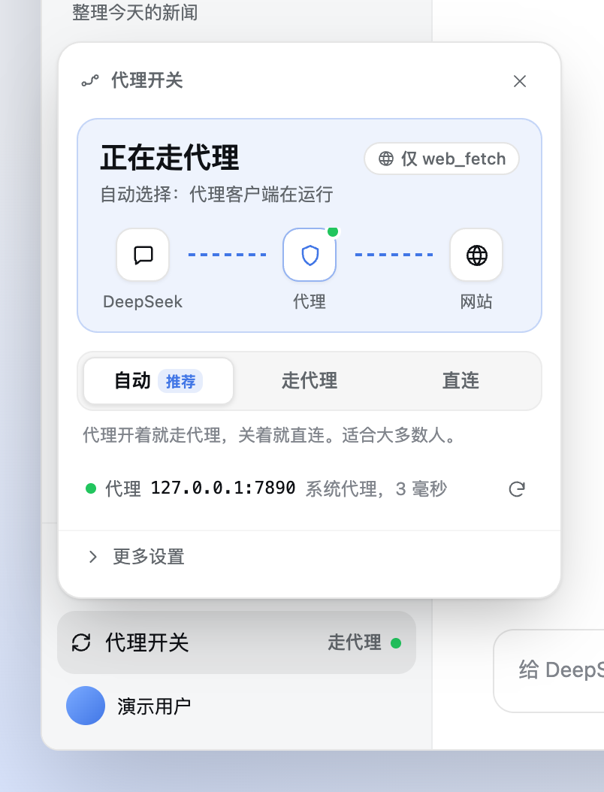
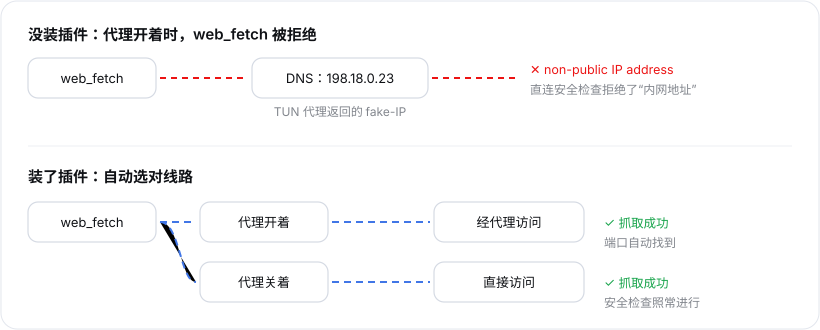
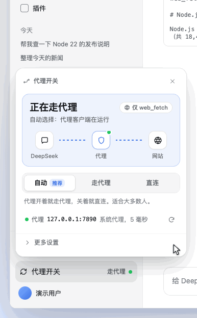
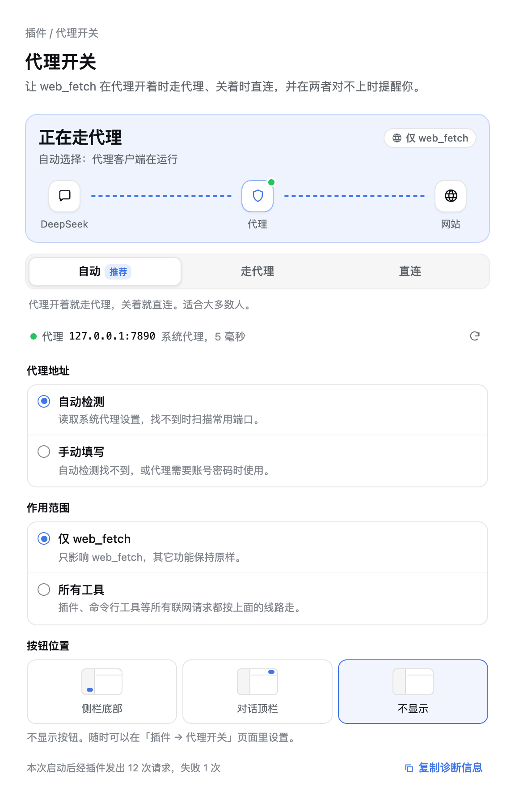
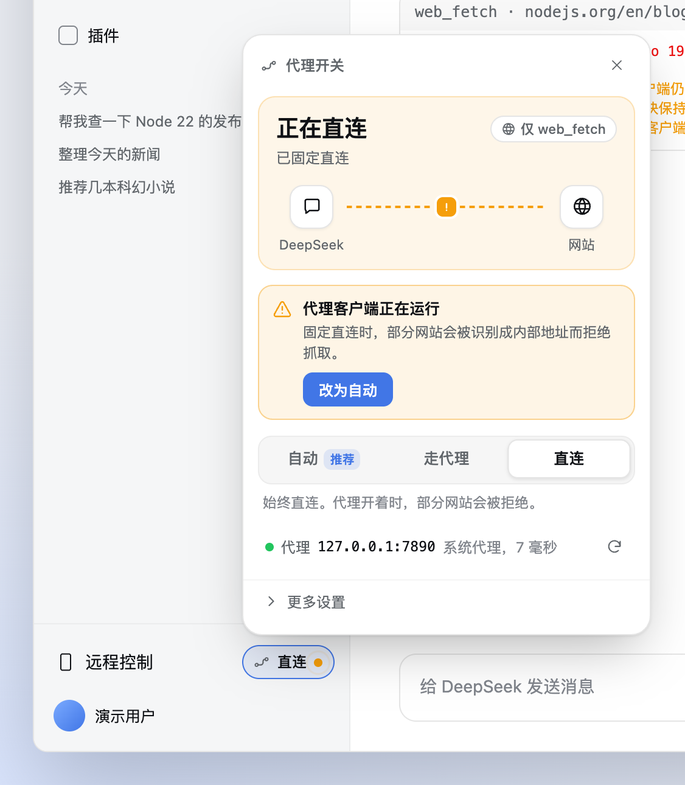
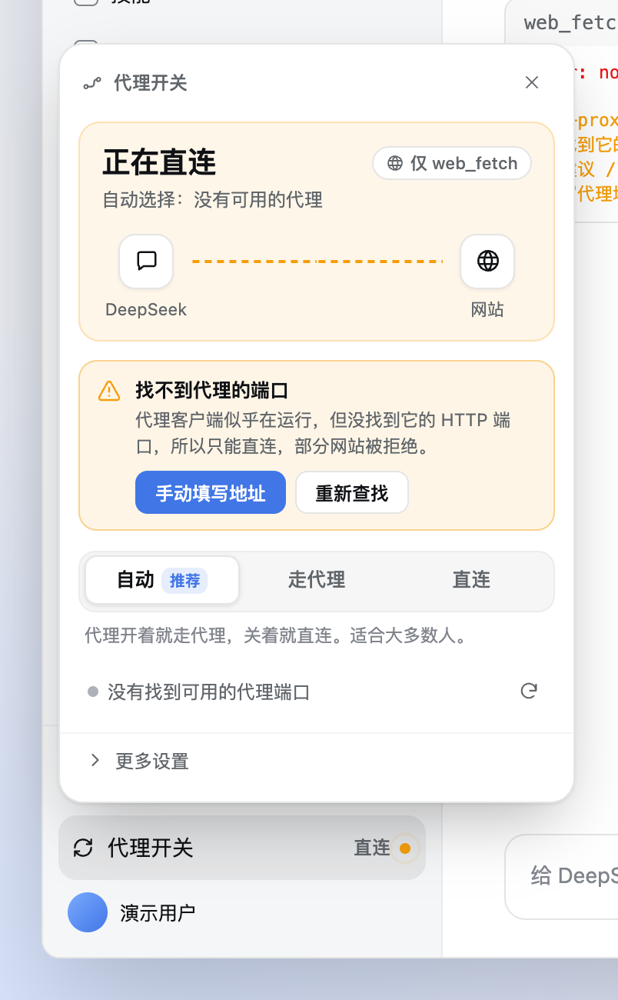
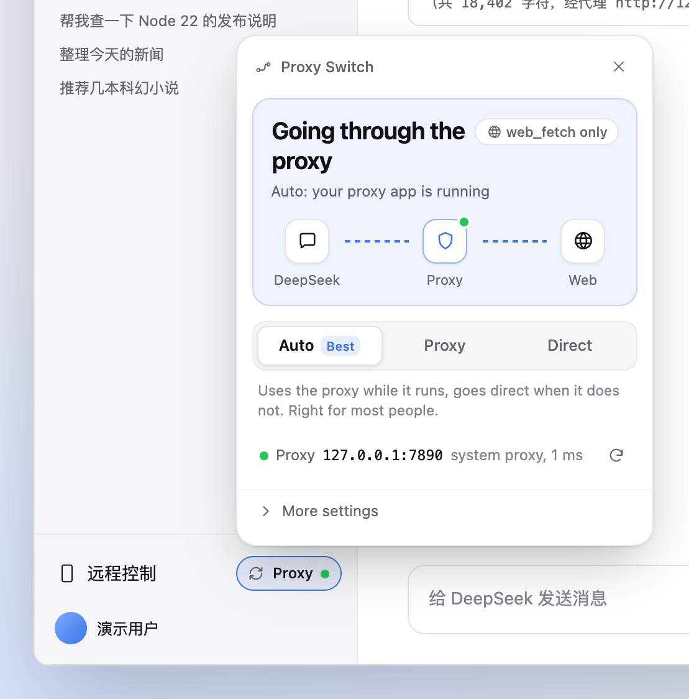

# 代理开关 · dsh-proxy-switch

[](https://github.com/lightrivers/dsh-proxy-switch/actions/workflows/test.yml)

**开着 Clash、Surge、v2rayN 这类代理软件时，DeepSeek Harness 的 `web_fetch` 抓不了网页？装上这个插件就好了。**

它会自动找到你电脑上的代理，代理开着就让 `web_fetch` 走代理，关着就直连。不用改 `.env`，也不用记端口号。

<p align="center">
  <picture>
    <source media="(prefers-color-scheme: dark)" srcset="docs/images/panel-dark.png">
    
  </picture>
</p>

[English](#english) · [安装](#安装) · [怎么用](#怎么用) · [看到提示怎么办](#看到提示怎么办) · [常见问题](#常见问题) · [工作原理](#工作原理)

---

## 它解决什么问题

如果你遇到过下面任何一种情况，这个插件就是为你写的：

- `web_fetch` 报错 **`non-public IP address`**，或者提示网站被解析到 **`198.18.x.x`**；
- 代理软件开了 **TUN / 增强模式 / fake-IP**，DeepSeek 一抓网页就失败；
- 为了让 `web_fetch` 能用，把 `HTTP_PROXY` 写死进了 `~/.dsh/.env`，结果代理一关，**连模型对话都断了**；
- 每次开关代理都要手动改配置。

<p align="center"></p>

原因在于：TUN 模式的代理会把所有域名解析成 `198.18.0.0/15` 段的"假地址"。`web_fetch` 直连时的安全检查不允许访问内网地址，于是把请求拒绝了；而一旦把代理写死，代理关掉后又什么都连不上。这个插件给 `web_fetch` 单独开了一条可以切换的线路，**默认不影响模型对话和其它功能**。

## 安装

1. 下载源码：
   ```bash
   git clone https://github.com/lightrivers/dsh-proxy-switch.git ~/dsh-proxy-switch
   ```
2. 在 DeepSeek Harness 里对模型说：「用 plugin_manager 安装插件 `~/dsh-proxy-switch`」（它会执行 `plugin_manager action=install_bundle target=<绝对路径>`）。
3. **完全退出并重新打开 DSH。** 侧栏底部右边会多出一个小按钮，显示当前线路和状态圆点（如「走代理 ●」）。

> 以前在 `~/.dsh/.env` 里写过 `HTTP_PROXY` / `HTTPS_PROXY` 的话，先删掉它们再重启。否则插件关掉后，DSH 还会回到写死的代理。

升级：在源码目录 `git pull`，再执行一次第 2、3 步。

## 怎么用

**大多数人什么都不用做。** 装好后默认是「自动」：插件读取系统代理设置，找到你的代理端口，代理在运行时 `web_fetch` 走代理，代理关掉后自动改为直连。

<p align="center"></p>

点侧栏底部的这个小按钮打开面板：

| 位置 | 说明 |
|---|---|
| **最上面一大块** | 现在走的是哪条线路。线条在流动表示通畅；出问题时，符号标在出问题的地方：✕ 表示那里断了，🔒 表示代理要登录，❗ 加时断时续的线表示不稳定（部分网站会失败）；灰线上有光点在扫表示正在检测。右上角的小标签是作用范围：「仅 web_fetch」或「所有工具」。 |
| **自动 / 走代理 / 直连** | 选线路。「自动」适合绝大多数人；另外两个会把线路固定住，不管代理开没开。 |
| **代理那一行** | 找到的代理地址、怎么找到的（系统代理、环境变量或端口扫描），以及延迟。右边的按钮可以重新检测。 |
| **更多设置** | 手动填写代理地址、作用范围、按钮放在哪里。 |

按钮上的圆点：🟢 正常，🟠 需要处理，🔴 出现问题，⚪ 正在检测。

### 按钮放哪里

左侧栏底部可能挤着好几个插件按钮。在「更多设置 → 按钮位置」里可以选：

- **侧栏底部**（默认）
- **对话顶栏**：适合侧栏常收起的人。Windows 上侧栏收起时，底部这一行会被隐藏。
- **不显示**：所有设置都还在「**插件 → 代理开关**」页面里，随时可以回来改。

<p align="center"></p>

## 看到提示怎么办

线路和代理状态对不上时，面板会给出一句话说明和一个修复按钮，点按钮就行。

<table>
<tr>
<td width="50%"></td>
<td width="50%"></td>
</tr>
<tr>
<td><b>代理客户端正在运行</b>：你固定了直连，但代理开着，部分网站会被拒绝。点「改为自动」。</td>
<td><b>找不到代理的端口</b>：代理似乎在运行，但它没有设置系统代理，端口也不常见。点「手动填写地址」，只填端口号（例如 <code>7890</code>）就行。</td>
</tr>
</table>

其它提示也一样，按按钮上写的做即可。`web_fetch` 的结果里也会附上同样的提示，模型能看到并告诉你。

## 常见问题

**会影响模型对话、搜索或者其它工具吗？**
默认不会。作用范围是「仅 web_fetch」，插件不修改全局网络设置、进程环境变量和子进程环境。只有你主动选择「所有工具」时，其它模块才会跟着走这条线路。

**我的代理软件端口不是 7890，能找到吗？**
能。插件优先读取**系统代理设置**（macOS 的网络设置、Windows 的 Internet 选项、Linux 的 GNOME/KDE 代理设置），所以无论什么端口，只要代理软件打开了「系统代理」就能找到。找不到时会再读取 DSH 启动时的 `HTTPS_PROXY` 等环境变量，最后扫描常见端口（7890、7897、6152、1087、10809 等）。每个候选地址都会实际握手验证，确认它真的是 HTTP 代理才会使用。

**自动模式会不会切错？**
每次 `web_fetch` 之前，插件会先在本机测一下代理端口（只需约 1 毫秒），所以代理刚关掉也不会走错线路。代理找不到时一律直连，直连的安全检查照常进行。

**代理需要账号密码怎么办？**
自动检测会发现它要求登录，并提示你手动填写 `http://user:pass@地址:端口`。密码只保存在本机，权限为 600，界面、日志和提示里一律显示为 `***`。

**走代理时，模型能借插件访问我的内网或本机服务吗？**
插件会尽量挡住，但不能保证百分之百。走代理时，网址最终由代理软件去解析和连接，插件看不到它实际连到了哪里。所以插件在交给代理之前先在本机检查一遍：`localhost`、`.local`、`.lan` 这类本地名字直接拒绝，在本机解析出内网地址的也拒绝。但开着 TUN 时本机只能解析到假地址（`198.18.x.x`），判断不了真实目标，只能放行。这和以前在 `~/.dsh/.env` 里手写 `HTTP_PROXY` 时的情况一样；直连则有完整的检查。

反过来，如果你的 DNS 被污染，把正常网站解析成了内网地址，走代理时这个网站会被误拒，提示里会写「转发模式拒绝请求」。打开代理软件的 TUN（或换一个可信的 DNS）就能恢复。

**支持 SOCKS、HTTPS 或 PAC 代理吗？**
目前只支持 HTTP 代理。好在几乎所有代理软件都提供 HTTP 端口或"混合端口"，用那个端口就行。

**支持 Windows、Linux 吗？**
代码按三个平台编写，自动检测会分别读取各自的系统代理设置，但目前只在 macOS 上完整验证过。欢迎反馈。

## 工作原理

```
web_fetch ──▶ 插件自己的 web_fetch 提供者 ──▶ 本机私有通道（随机端口，只监听 127.0.0.1）
                                                ├─ 走代理：CONNECT / 绝对 URI ──▶ 你的 HTTP 代理
                                                └─ 直连：  解析 DNS + 安全检查 ──▶ 目标网站
```

- 插件只替换 `web_fetch` 的"发请求"这一步。重定向、超时、大小限制、编码处理仍然沿用 DSH 原来的实现。
- 直连时，整组 DNS 结果都必须是公网地址：fake-IP、内网、回环、NAT64 内嵌私网地址等一律拒绝。
- 走代理时，本地名字和在本机解析成内网地址的目标会被拒绝；最终由代理解析，所以这只是缓解（见上面的常见问题）。
- 私有通道每次启动生成随机令牌，本机其它程序无法借用它（以及你保存的代理账号密码）。
- 每个请求都使用新连接，切换线路后不会沿用旧的代理隧道。
- 设计细节、安全边界和测试覆盖见 [docs/ARCHITECTURE.md](docs/ARCHITECTURE.md)。历史审查记录见 [REVIEW.md](REVIEW.md)。

### 配置与状态文件

面板里能改的设置都保存在 `~/.dsh/storages/dsh-proxy-switch/state.json`（目录权限 0700、文件权限 0600）。一般不需要手动编辑。

| 字段 | 默认 | 说明 |
|---|---|---|
| `mode` | `auto` | `auto`（跟随检测结果）/ `forward`（固定走代理）/ `direct`（固定直连） |
| `upstreamSource` | `auto` | `auto` 时代理地址由检测结果更新；`manual` 时只使用你填写的地址 |
| `upstream` | `http://127.0.0.1:1082` | 代理地址，只接受 `http://host:port`，可以带 `user:pass@` |
| `scope` | `web_fetch_only` | `web_fetch_only`（仅 web_fetch）/ `global`（所有工具） |
| `listenPort` | `7899` | 仅「所有工具」模式使用的本地端口 |
| `probeIntervalMs` | `15000` | 后台检测代理的间隔（3000–600000 毫秒），界面里不提供修改 |

按钮位置是浏览器端的偏好，保存在 `localStorage` 的 `dsh-proxy-switch.placement` 里。

从 0.3 升级时，原来的线路选择会保留。原来的代理地址如果是默认值，会改为自动检测；如果是你填写过的地址，会保持手动。

### 状态接口

```
GET  /dsh-proxy-switch/state
POST /dsh-proxy-switch/mode      { "mode": "auto" | "forward" | "direct" }
POST /dsh-proxy-switch/settings  { "scope"?, "upstream"?, "upstreamSource"?, "listenPort"?, "probeIntervalMs"? }
POST /dsh-proxy-switch/probe     立即检测一次当前代理
POST /dsh-proxy-switch/detect    立即重新查找代理
```

接口只接受本机请求，`Host` 必须是 DSH 自己的地址，并校验 `Origin`、`Sec-Fetch-Site`；`POST` 还要求 `Content-Type: application/json` 和请求头 `x-dsh-proxy-switch-request: 1`。`state` 里的主要字段有：`mode`、`effectiveMode`（当前实际走的线路）、`upstream`（已脱敏）、`upstreamSource`、`detection`、`probe`、`warning`、`provider`、`scope`、`stats`。

## 开发与测试

```bash
npm test                                   # 单元测试（含 Client 渲染测试）
DSH_RUNTIME_MODULES=/path/to/dsh/node_modules node scripts/e2e-host.mjs   # 真实 Cordis/WebRuntime 集成测试
node scripts/e2e-real.mjs                  # 可选：经过本机真实 HTTP 代理
node scripts/e2e-web-fetch-warning.mjs     # web_fetch 结果附带的警告文本
```

`DSH_RUNTIME_MODULES` 指向 DSH 运行时的 `node_modules`。可以从安装包里解出来：`npx @electron/asar extract "/Applications/DeepSeek Harness.app/Contents/Resources/app.asar" out`，然后使用 `out/dsh/node_modules`。

依赖必须写在 `peerDependencies` 里，不能写进 `dependencies`，否则会装出第二份 `@deepseek-ai/dsh-http-proxy`，「所有工具」模式会静默失效。

## 卸载

1. 对模型说「用 plugin_manager 卸载 dsh-proxy-switch」（`remove_bundle`），然后重启 DSH。
2. 删除 `~/.dsh/storages/dsh-proxy-switch/`。
3. 如果需要恢复写死的代理，把 `HTTP_PROXY` / `HTTPS_PROXY` 写回 `~/.dsh/.env` 并重启。

---

## English

**DeepSeek Harness `web_fetch` failing with `non-public IP address` while Clash / Surge / v2rayN runs in TUN (fake-IP) mode? This plugin fixes it.**

It finds your local HTTP proxy automatically (system proxy settings on macOS/Windows/Linux, then `HTTPS_PROXY`-style variables, then common ports, each verified with a real `CONNECT` handshake). In **Auto** mode, `web_fetch` goes through the proxy while the proxy runs and goes direct when it does not. Model calls and other tools are untouched by default.

<p align="center"></p>

- **Install:** clone the repo, ask DSH to run `plugin_manager action=install_bundle target=<absolute path>`, then fully restart DSH. Remove any hard-coded `HTTP_PROXY` from `~/.dsh/.env`.
- **Use:** click the small Proxy Switch pill at the bottom of the sidebar. Choose **Auto** (recommended), **Proxy**, or **Direct**. A tag on the panel shows whether the switch applies to *web_fetch only* or *all tools*.
- **When something is off,** the route diagram marks the spot (✕ broken, 🔒 proxy wants a login, ❗ unstable), and the panel shows one sentence and a button that fixes it, such as *Switch to Auto* or *Enter the address*.
- **Button location:** sidebar footer, chat header, or hidden. The full panel is always available under *Plugins → Proxy Switch*.
- HTTP upstreams only (use your proxy app's HTTP or mixed port). Fully verified on macOS so far.
- **Security note:** direct mode checks every DNS answer. In proxy mode the proxy resolves the name, so the plugin can only refuse local names and names that already resolve to private addresses on this machine; under fake-IP it cannot see the real target. This is a mitigation, not a guarantee.

Design, security boundaries, and test coverage: [docs/ARCHITECTURE.md](docs/ARCHITECTURE.md).

## License

MIT
